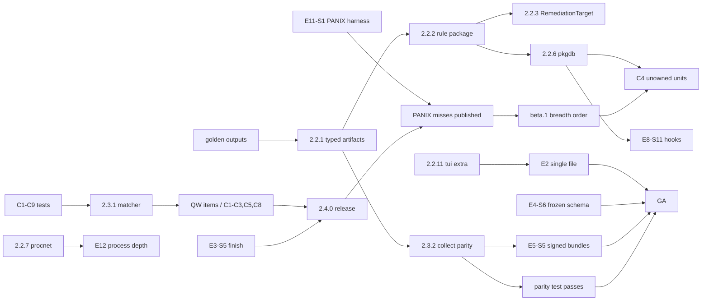

# ubuntils v3.0.0 — engineering and delivery plan

| | |
|---|---|
| Status | Regenerated 2026-11-10; replaces the lost original (never committed) |
| Baseline code | `v3-dev` @ `e864eed` = `origin/feat/v3.0.0` (`29fc4e6`) + 2.3.0 (`3a02911`), `__version__ = "3.0.0.dev0"` |
| Companion docs | `v3.0.0-prd.md` (what and why), `id-registry.md` (every ID), `../reviews/2.3.0-response.md` |
| Owner | the maintainer (solo) |

Section numbers in this document are part of the contract: code and commit
messages already cite §2.2.2, §2.2.9, §2.2.10 and §3. Never renumber them.

---

## 0. What was measured for this plan

Everything here was run on 2026-11-10 on the maintainer's development machine
(macOS, Apple silicon, Python 3.11.5). That host has no Ubuntu, no root, no
container runtime and no network to GitHub, which limits what could be run.

| Measurement | Result | Notes |
|---|---|---|
| Test suite | **663 passed, 1 skipped** in ~20 s | Skip: `tests/test_bridge_2_3.py:383` needs root-owned files. CI (Linux, 20 matrix cells) is the authority. |
| Coverage, overall | **94.41 % line** (3,868 / 4,097), **88.69 % branch** (1,176 / 1,326), 93.01 % combined | `pytest --cov=ubuntils --cov-branch`; today's CI gate is 90 % line, no branch gate. |
| Lab (`tools/lab/seed-lab.sh`) | **not run** | needs a disposable Ubuntu VM and root. Last recorded: 16 / 16 artifacts flagged on `96f3c49` (`tools/hostile-host/RESULTS.md`, 2026-10-23, Ubuntu 24.04 container). `tests/test_lab_script.py` (lab ↔ rules sync) passes. |
| fp-suite (`tools/fp-suite`) | **not run** | no Docker on this host. Known from `c8734ee`: `ubuntu:24.04` gives 7 LOW `SHELL_RC_MODIFICATION`. |
| `collector_durations_s` | **not measured** | needs a live Ubuntu host. Prior numbers: full scan 29–68 s on a 26.04 arm64 desktop VM, dominated by `dpkg --verify` (README "What ubuntils does", 2.2.0); 21.6 s baseline in a 24.04 container (RESULTS.md). `<BASELINE: run "ubuntils scan --json --no-wazuh" 5× on the reference 24.04 VM and take the median of scan_metadata.collector_durations_s per collector>` |
| Hostile-host harness | **not run** | last result: all 7 robustness traps PASS, all 5 visibility traps SEEN (RESULTS.md). |

### Coverage per package (line / branch)

| Package | Line | Branch | Statements / branches |
|---|---|---|---|
| `ubuntils` (cli, pipeline) | 90.73 % | 87.32 % | 496 / 142 |
| `ubuntils/bundle` | 96.68 % | 97.83 % | 211 / 46 |
| `ubuntils/collectors` | 94.67 % | 88.94 % | 1,088 / 398 |
| `ubuntils/detectors` | 97.87 % | 95.89 % | 751 / 316 |
| `ubuntils/formatters` | 100.00 % | 88.89 % | 45 / 18 |
| `ubuntils/integrations` | 98.77 % | 95.83 % | 81 / 24 |
| `ubuntils/remediators` | 92.42 % | **80.00 %** | 409 / 80 |
| `ubuntils/timeline` | 93.36 % | 96.77 % | 211 / 62 |
| `ubuntils/tui` | 93.46 % | **78.03 %** | 459 / 132 |
| `ubuntils/utils` | 92.49 % | **77.78 %** | 346 / 108 |

### Security-critical modules (the 100 % targets in §7)

| Module | Line | Branch |
|---|---|---|
| `utils/safe_path.py` | **82.02 %** | **55.00 %** |
| `utils/safe_io.py` | 95.38 % | 80.77 % |
| `utils/validators.py` | 100 % | n/a (no branches) |
| `utils/shell.py` | 94.74 % | 75.00 % |
| `bundle/writer.py` | 92.65 % | 83.33 % |
| `bundle/reader.py` | 97.92 % | 100 % |
| `bundle/manifest.py` | 100 % | 100 % |
| `remediators/base.py` | 94.56 % | 87.50 % |
| `remediators/rollback.py` | 84.38 % | 81.25 % |
| `remediators/preserve.py` | 97.22 % | 100 % |
| `remediators/sudoers.py` | 88.10 % | 58.33 % |
| `cli.py` (re-exec, install trust) | 87.10 % | 83.96 % |
| `collectors/network.py` (`ss` parser) | 95.00 % | 86.36 % |
| `collectors/processes.py` (`/proc`) | 95.12 % | 87.50 % |
| `collectors/source.py` (bounded reads) | 98.68 % | 96.15 % |

The least-covered security-critical functions (from the same run):
`safe_path.replace_at` 59 %, `safe_path.open_dir_nofollow` 77 %,
`safe_path.open_parent` 67 %, `cli._file_problem` 41 %,
`sudoers._run_visudo_check` 0 %, every remediator's `verify()` 50 %,
`rollback._load` 69 %, `cli._collect_full_bundle` 0 %, `cli._bundle_sha256` 0 %.
The atomic-replace path and the visudo gate are the two that matter most:
they are exactly what F-04 and audit C3 fixed, and their failure branches are
untested.

---

## 1. Verification table

Every ID is defined in `id-registry.md`. Status is as of `v3-dev` @ `e864eed`.
"Story" is the story that delivers or delivered it.

### 1.1 Security review F-01…F-14

| ID | Status | Evidence | Regression tests | Story |
|---|---|---|---|---|
| F-01 | done 2.3.0 | `remediators/rollback.py:83`; `rollback_command` is always `ubuntils rollback …` | `test_F01_*` ×7 | E1-S2 |
| F-02 | done 2.3.0 | `utils/safe_io.py:21`; `cli.py:39,328` | `test_F02_*` ×7 | E13-S5 |
| F-03 | done 2.3.0 | `detectors/rules.py:337-347` (`AMBIGUOUS_KEY` block) | `test_F03_*` ×8 | E1-S3 |
| F-04 | done 2.3.0 | `utils/safe_path.py:31` | `test_F04_*` ×3 | E1-S2 |
| F-05 | done 2.3.0 | `collectors/source.py:19,82,142`; `rules.py:1173` | `test_F05_*` ×5 | E13-S7 |
| F-06 | done 2.3.0, deferred part open | `collectors/network.py:73-85`; inode→PID map not built | `test_F06_*` ×5 | §2.2.7 |
| F-07 | done 2.3.0 (+N-08) | `cli.py:179-255` | `test_F07_*` ×5 | E13-S8 |
| F-08 | done 2.3.0 | `bundle/reader.py:83,157` | `test_F08_*` ×3 | E5-S5 |
| F-09 | done 2.3.0 | `integrations/wazuh.py:20-22` | `test_F09_*` ×5 | E7-S2 |
| F-10 | done 2.3.0 | `bundle/reader.py:17` | `test_F10_*` ×3 | E5-S6 |
| F-11 | done 2.3.0 | `requirements.lock`, `requirements-dev.lock`, `ci.yml`, `.github/dependabot.yml` | `test_F11_*` ×3 | E13-S1 |
| F-12 | done 2.3.0 | `detectors/custom_rules.py:29` | `test_F12_*` ×2 | E10-S3 |
| F-13 | done 2.3.0 | `tui/confirm_modal.py:61` | `test_F13_*` ×1 | — |
| F-14 | done 2.3.0, documented gaps open | `utils/validators.py:16`; README "Not covered" | `test_F14_*` ×2 | E8-S4, E8-S10 |

### 1.2 Maintainer findings N-

| ID | Status | Evidence | Story |
|---|---|---|---|
| N-01 | done 2.3.0 | `pipeline.py:218-227`; `test_N01_*` | E13-S7 |
| N-02, N-04, N-07, N-11, N-13 | reserved: unrecovered | searched `git log --all --grep`, every commit body, CHANGELOG, comments, test names | — |
| N-03, N-06 | done 2.3.0 | `ba1fb91`; `test_N03_*`, `test_N06_*` | E11-S2 |
| N-05 | done 2.3.0 | `87492d7`; `test_N05_*` | E13-S1 |
| N-08 | done v3-dev | `e2b7229`; `test_N08_*` | E13-S8 |
| N-09 | done v3-dev | `46d9573`; `test_N09_*` | E13-S7 |
| N-10 | done 2.3.0 | `7274fc5`; `test_N10_*` | E13-S1 |
| N-12 | done 2.3.0 | `1319b5a`; `tests/test_lab_script.py:64` | E11-S3 |
| N-14 | done 2.3.0 | `test_N14_*` | E3-S2 |
| N-15 | done 2.3.0 | `b7e06c4`; `test_N15_*` | E1-S3 |
| R0-5 (lost plan) | done 2.3.0 | `cli.py:396-420`; `test_R05_*` | E13-S3 |

### 1.3 Review items

Full verdicts with evidence are in `id-registry.md` §7. Summary:

| ID | Verdict | Story | Release |
|---|---|---|---|
| R-01 | Confirmed | E2-S1, E2-S2 | 3.0.0 (experimental zipapp from alpha.2) |
| R-02 | Confirmed | E5-S1, E5-S2 | 3.0.0-alpha.2 |
| R-03 | Confirmed | E8-S2…E8-S4, E8-S8…E8-S11 | 3.0.0-beta.1 |
| R-04 | Confirmed | E8-S1 | 2.4.0 |
| R-05 | Confirmed | E12-S1, E12-S2 (location part in 2.4.0 via E8-S7) | 3.0.0-beta.1 |
| R-06 | Partly | E12-S3 (auth.log in 2.4.0), E12-S4 | 2.4.0 / beta.1 |
| R-07 | Partly | E3-S4, E3-S5, E3-S6 | 2.4.0 (containers) / beta.1 (VMs) |
| R-08 | Confirmed | E7-S1, E5-S4, E1-S6, E13-S5 | 2.4.0 (staging, notice) / beta.2 (opt-in default) |
| R-09 | Confirmed | E5-S5, E13-S1 | 3.0.0-beta.2 |
| R-10 | Changed (2 of 3 halves done on v3-dev) | E4-S4, E4-S6, E13-S3 | 2.4.0 (`host_id`) / beta.2 (frozen schema) |
| C1, C2, C3, C5 | Confirmed | E8-S4, E8-S7, E8-S1/S2, E8-S6 | 2.4.0 |
| C8 | Partly (regex yes, recency no) | E8-S1, E8-S14 | 2.4.0 |
| C4, C6, C7, C9 | Confirmed | E8-S3, E8-S5, E8-S8, E8-S9 | 3.0.0-beta.1 |
| RL-01…RL-14 | Confirmed (all 14) | E8-S2…E8-S15 | RL-03 (options), RL-08, RL-09, RL-10, RL-13 (paths) in 2.4.0; rest beta.1 |
| QW-1…QW-11 | Confirmed open | see registry | 2.4.0 |
| QW-12 | Partly (final path done by F-02; staging open) | E5-S4 | 2.4.0 |
| QW-13 | Confirmed | E8-S3 | alias 2.4.0, switch 3.0.0 |

**Reviewer claims refuted or corrected** (recorded, no work planned for them):
1. **C8's "older than 48 h"** is not why it is missed. Content signals fire at
   any age since 2.2.0 (audit D2, `rules.py:697-701`); the miss is the regex
   (`rules.py:664`). The fix is the matcher, not the window.
2. **R-06's "no journal offline"** is true for `analyze --root` only. A bundle
   replays 7 days of captured journal (`cli.py:79`).
3. **R-07's "one VM and one container"** undercounts: a 26.04 arm64 VM, a
   24.04 KVM guest and `ubuntu:24.04` containers. The substance (no corpus)
   stands.
4. **R-10** was right about 2.3.0 but is two-thirds closed on `v3-dev`.
5. **QW-12**: the finished bundle already defaults to `/var/lib/ubuntils/bundles`
   (F-02); only the staging copy is in the temp dir.
6. The cited commit `3b71b86` does not resolve locally; 2.3.0 is `2304232`.

---

## 2. Target architecture

### 2.1 Overview

```
                          ┌──────────────────────── ArtifactSource ────────────────────────┐
                          │ LiveSource(root="/")   LiveSource(root=img, offline)  BundleSource│
                          │   read_text · read_user_file · lstat · glob · readlink · run    │
                          │   + ReadSetRecorder (§2.3.2): every path/command a collector    │
                          │     touched, so `collect` captures exactly that                 │
                          └───────────────▲─────────────────────────────────────────────────┘
                                          │ bounded, non-blocking, contained reads
   ┌──────────────┐   typed artifacts     │
   │ collectors/  │──(§2.2.1 artifacts/)──┘          pkgdb/ (§2.2.6)   procnet (§2.2.7)
   │ 11 today,    │      ↑ degraded[] reasons             ↑ owner_of(path)    ↑ /proc/net + fd inodes
   │ +hooks pack  │──────┴──────────────────────────────────┴───────────────────┘
   └──────┬───────┘
          │ ArtifactSet (typed, versioned)
          ▼
   ┌───────────────────────────────┐    ┌──────────────────────────┐
   │ rules/ package (§2.2.2)       │◄───│ analysis/cmdmatch.py      │ shared matcher (§2.3.1)
   │ @rule(id, severity, category, │    │ data/*.yaml allowlists    │ (§2.2.8)
   │       attack, consumes, alias)│    └──────────────────────────┘
   └──────┬────────────────────────┘
          │ Finding (+finding_id, sha256, RemediationTarget §2.2.3, blocked_reasons §2.2.5)
          ▼
   engine: custom rules → allowlist → baseline (hash-keyed) → scoring
          │
          ├─► timeline/ builder + correlator (E12)
          ├─► formatters: JSON (schema 3.x, §2.2.9) · Markdown (E4-S2) · Wazuh JSONL (opt-in, E7)
          ├─► tui/ (optional extra, §2.2.11)
          └─► remediation (opt-in): gate → preserve (E1-S4) → safeio/ (§2.2.4) → rollback
```

Invariants every item below must keep (the review's "must not regress" list):
no network calls; never execute host data; every reader bounded and
non-blocking on user files; "could not look" is reported as degraded, never as
clean; remediation opt-in, preserved, backed up and minimal; explainable
weighted signals.

### 2.2 Architecture items (order fixed)

#### 2.2.1 Typed artifact schemas

- **Problem.** Collectors return free-form dicts (`pipeline.py:177`
  `artifacts.update(result)`); a key typo or a missing field silently yields
  no findings. Custom rules, `collect` parity and the offline/live parity test
  all need to know what an artifact *is*.
- **Current state.** Untyped `dict[str, list[dict]]`; the shape is documented
  only by tests and by the rules that read it.
- **Target.** `ubuntils/artifacts/` with one frozen dataclass per artifact kind
  (`CronEntry`, `SystemdUnit`, `AuthorizedKey`, `ProcessInfo`, `Socket`,
  `SudoersRule`, `Account`, `ShellInitFile`, `EnvDefinition`, `PackageVerifyEntry`,
  `PamFile`, `KernelModule`, `SetuidFile`, `FileAttr`, …), each with
  `source_path`, `parent_dir_id`, `collected_via` (`file|command|proc`),
  and an `ArtifactSet` container with `degraded: dict[str, list[str]]`.
  Dataclasses, not pydantic (no new runtime dependencies). A `to_dict()`
  keeps the current shape for rules not yet migrated.
- **Modules.** `collectors/*`, `pipeline.py`, `detectors/custom_rules.py`, tests.
- **Migration.** (1) Add types plus `to_dict()`; collectors construct types
  and the pipeline converts back to dicts, so rules are untouched. (2) Migrate
  rules area by area during §2.2.2. (3) Remove `to_dict()` at beta.1.
- **Tests.** A `hypothesis` round-trip per type; golden outputs (§7) unchanged
  across steps 1 and 2; a test that every collector returns only declared
  types.
- **Risk.** Medium: wide but mechanical. Golden outputs are the safety net,
  so they must land first (alpha.1).

#### 2.2.2 Rule package with decorator registration and metadata

- **Problem.** `detectors/rules.py` is 1,211 lines and 17 rules; registration
  is a hand-kept list (`engine.py:30`); metadata lives apart in
  `data/rule_meta.yaml`. Adding the ~15 rules E8 needs to one file does not
  scale, and contributors cannot find where to start.
- **Current state.** One module; E4-S1 kept metadata as data
  (`rule_meta.py` docstring) deliberately so it would survive this refactor.
- **Target.** `ubuntils/rules/{cron,systemd,ssh,accounts,sudoers,process,network,
  loader,shell,packages,pam,kernel,files,hooks}.py`. Each rule is decorated:
  `@rule(id="CRON_SUSPICIOUS_COMMAND", severity=HIGH, consumes=("cron_entries",),
  aliases=(), remediable=False)`. Category and ATT&CK stay in
  `rule_meta.yaml` (reviewed as data); a test asserts the YAML and the
  registry list the same IDs. Aliases support the QW-13 rename.
- **Modules.** `detectors/rules.py` → `rules/`, `detectors/engine.py`, `rule_meta.py`,
  `CONTRIBUTING.md`.
- **Migration.** Move one area per commit with no behaviour change; golden
  outputs and the full suite gate each move; `detectors/rules.py` re-exports
  until 3.0.0 (internal API, no deprecation needed).
- **Tests.** Registry/YAML parity; every rule has a positive and a clean
  fixture (enforced by a meta-test); mutation score per rule file (§7).
- **Risk.** Low behaviour risk, medium churn. Do it before E8 breadth, not after.

#### 2.2.3 Structured `RemediationTarget` on `Finding`

- **Problem.** Remediators find what to change by matching `raw_value` text in
  `artifact_path`. That coupling caused the 2.3.0 "Line not found" bugs (cron
  remediation never worked on a real host; indented lines).
- **Current state.** `Finding.raw_value`, `artifact_path`,
  `parent_dir_identity` (`finding.py:38-61`); remediators re-parse.
- **Target.** `RemediationTarget(path, kind="line"|"entry", line_exact,
  line_number_hint, file_sha256_at_detection, parent_dir_identity)`, set by
  the rule from the typed artifact. Remediators refuse if the file's SHA-256
  changed since detection (unless the TUI's manual path, behind the warning).
  `raw_value` stays as display text.
- **Modules.** `detectors/finding.py`, remediable rules, `remediators/*`, `preserve.py`, JSON.
- **Migration.** Add the field (JSON additive), make remediators prefer it,
  then drop the text fallback in 3.0.0.
- **Tests.** Every remediator against a target whose file changed (refused), a
  moved line (found by exact match), an indented line; the existing F-01/F-04
  tests unchanged.
- **Risk.** Medium: touches the most safety-critical path. No new remediation
  capability (out of scope for 3.0).

#### 2.2.4 Dir-fd-relative safe-I/O module

- **Problem.** Root-run reads and writes must never follow a symlink in any
  path component. The code exists (F-04) but is split between
  `utils/safe_path.py` and `utils/safe_io.py` and used by remediation only;
  bundle staging, preserve, rollback and reports each reach it differently.
- **Current state.** Partial. `safe_path.open_dir_nofollow` and `replace_at`
  (82 % line / 55 % branch), `safe_io.open_private_for_write`.
- **Target.** One `ubuntils/safeio/` package: `open_dir(path) -> DirFd`,
  `read_at`, `write_atomic_at` (O_EXCL temp, fsync, fchown/fchmod, renameat),
  `private_dir` (0700, root-owned, not a symlink), `open_private_for_write`.
  Every root-run write goes through it; a test greps for bare `open(` in
  write mode outside `safeio/`.
- **Modules.** `utils/safe_path.py`, `utils/safe_io.py`, `remediators/*`,
  `bundle/writer.py`, `cli.py`, `integrations/wazuh.py`.
- **Migration.** Move with re-exports; then route the bundle writer and the
  Wazuh writer through it.
- **Tests.** 100 % line and branch, enforced per module (§7). Fault injection
  for every `OSError` branch (ENOSPC, EXDEV, EACCES, ELOOP).
- **Risk.** Low if done as a move. It must not be rewritten.

#### 2.2.5 Hard `auto_remediation_blocked` reasons

- **Problem.** A score alone let `--remediate --confirm` remove an admin's
  only key (N-15) and every key in a multi-key file (F-03).
- **Current state.** **Done in 2.3.0** (E1-S3, `b7e06c4`): `blocked_reasons`
  `[{code, detail}]`, codes `AMBIGUOUS_KEY`, `RECENCY_ONLY`,
  `SOLE_SUDO_ACCESS`, checked before `--min-confidence` (`pipeline.py:79-102`).
  `auto_remediation_blocked` (string) is kept for 2.x consumers.
- **Remaining.** Codes become an enum in the schema; every new remediable rule
  must declare which blocks apply; `auto_remediation_blocked` stays through
  3.x (announced in 2.3.0).
- **Tests.** Existing `test_N15_*`, `test_F03_*`; a meta-test that every
  remediable rule has a block-coverage test.

#### 2.2.6 Package-manager abstraction

- **Problem.** C4 (unowned unit), RL-05 (unowned `sudoers.d`), RL-11
  (unowned PAM module), E8-S11 (unowned hooks) and E9 all need "which package
  owns this path?". Today only `dpkg-query -S` exists, as a command, and only
  for `dpkg --verify` output (`collectors/packages.py`).
- **Target.** `ubuntils/pkgdb/`: `PackageDB.owner_of(path) -> str | None`,
  `is_conffile(path)`, `verify() -> entries`, `state(pkg)`. The dpkg
  implementation reads `/var/lib/dpkg/info/*.list`, `*.conffiles`, `*.md5sums`
  and `/var/lib/dpkg/status` **as files through the ArtifactSource**, so
  ownership works offline and in bundles with no command. `dpkg --verify` stays
  a command (live) or is recomputed from `md5sums` offline (beta.1 stretch).
  The RPM implementation is E9-S2 (3.1 decision).
- **Bounds.** `*.list` files are root-owned but can be large; read through
  `_read_capped`; build the path→package index lazily; record degraded on any
  unreadable list.
- **Tests.** Fixture dpkg databases (stock 24.04 subset, a removed-not-purged
  package, a diverted file); parity with `dpkg-query -S` on the reference VM.
- **Risk.** Medium (diversions, multi-arch `pkg:arch.list` names). It is on the
  critical path for C4.

#### 2.2.7 /proc-based socket ownership

- **Problem.** Socket ownership comes from parsing `ss -tunap`, which carries
  attacker-chosen process names (F-06) and is a command that can be trojaned.
  Listeners (QW-2) and hidden-socket checks (E12) need ownership that does not
  depend on `ss`.
- **Current state.** Hardened `ss` parser with a `/proc/<pid>/comm` cross-check
  (`network.py:73-85`); the inode→PID map was deferred from F-06.
- **Target.** `collectors/procnet.py`: parse `/proc/net/{tcp,tcp6,udp,udp6}`
  (fixed-format hex, bounded line count), map socket inodes from
  `/proc/<pid>/fd/*` readlinks (`socket:[inode]`), and keep `ss` as a
  cross-check: a socket in `ss` but not `/proc/net`, or the reverse, is a
  degraded/hidden-socket signal (E12-S2). `collect` captures `/proc/net/*`
  and the fd link targets.
- **Tests.** `hypothesis` on the hex parser; fixtures with v4-mapped addresses;
  PID reuse between the two reads.
- **Risk.** Low-medium; fd enumeration is the slow part on busy hosts (bound it
  and record truncation as degraded).

#### 2.2.8 Data-file allowlists

- **Problem.** `KNOWN_SETUID_BINARIES`, `KNOWN_SETGID_BINARIES`,
  `ALLOWED_KERNEL_MODULES`, `ALLOWED_NSS_MODULES` (`utils/validators.py`),
  `KNOWN_SYSTEM_BINARIES` and `_COMMON_REMOTE_PORTS` (`rules.py:25-40`) are
  code. Every false-positive fix is a code change, and contributors cannot see
  why an entry is there.
- **Target.** `ubuntils/data/allowlists/*.yaml`, each with `version`, and
  per-entry `reason`, `distro` (e.g. `ubuntu>=25.10`), `arch`, `added_in`.
  Loaded with `importlib.resources` (works from a zipapp, as `rule_meta.py`
  already does). The schema is validated by a test.
- **Migration.** One list per commit; golden outputs unchanged.
- **Tests.** Every entry has a reason; no duplicates; zipapp loading test.
- **Risk.** Low.

#### 2.2.9 Schema versions plus compatibility policy

- **Policy (fixed meaning).** A **minor** schema bump only adds fields or enum
  values; only a **major** may remove or rename one. Schema versions are
  independent of the tool version. 2.x reports have no `schema_version`.
- **Current state.** Implemented by ARCH-SV (`1648f28`): report
  `schema_version "3.0"` (`json_formatter.py:11`), Wazuh `"3"`
  (`wazuh.py:29`), bundle `format_version: 1` (`manifest.py:10`); `analyze`
  refuses newer bundle formats.
- **Target (E4-S6, E13-S4).** `schemas/report-3.json`, `schemas/wazuh-3.json`,
  `schemas/bundle-manifest-2.json` (JSON Schema 2020-12) checked in. A test
  validates every golden output against them, using a vendored minimal
  validator in `tests/` (no runtime dependency; `jsonschema` is fine as a
  hash-pinned dev dependency). The schema freezes at beta.2. Bundle format 2
  is the `collect`-parity format (§2.3.2); format 1 stays readable through
  3.x (E5-S6).
- **Enum additions are minor.** The category gains `inventory` (E3-S7). This
  is called out in the migration guide, because a strict consumer may reject
  an unknown value.

#### 2.2.10 A measured decision on parallel collection

- **Data needed.** `scan_metadata.collector_durations_s` (added by ARCH-SV,
  `pipeline.py:181-206`). **Not yet measured on Ubuntu**; this plan's host
  can't run a live scan. Prior evidence: 29–68 s on a 26.04 arm64 VM,
  dominated by `dpkg --verify` (timeout 600 s) and the setuid `find` (300 s);
  21.6 s in a 24.04 container.
- **Method.** `<BASELINE: on the reference 24.04 VM and one large host (≥ 2,000
  packages), run 5 scans; record median per-collector seconds and peak RSS
  (/usr/bin/time -v)>`.
- **Decision rule.** If `PackageCollector` alone is ≥ 60 % of wall time,
  run it in **one** background thread alongside the remaining collectors (I/O
  and subprocess-bound, so the GIL is not the limit). Results are merged in
  registry order so the output stays deterministic. Otherwise stay
  sequential. No process pools: they would complicate the root re-exec and
  the zipapp.
- **Constraints.** Per-collector timeouts reported as degraded (E13-S6);
  deterministic ordering for golden outputs; progress callback order in the TUI.
- **Decide by.** End of alpha.2.

#### 2.2.11 Optional `ubuntils[tui]` extra

- **Problem.** Textual pulls in 8 of the 15 runtime packages
  (`requirements.lock`: textual, rich, pygments, markdown-it/mdit/linkify,
  platformdirs, typing-extensions), and it cannot go into the single file.
- **Current state.** `cli.py:21` imports `UbuntilsApp` at module import; the
  2.3.0 help epilog announces the extra.
- **Target.** Core dependencies: click, structlog, pyyaml, python-dateutil.
  `pip install 'ubuntils[tui]'` adds textual. `scan` without `--json`, when
  textual is missing, prints a summary table to stderr, writes JSON only
  with `--json/--output`, and says how to get the TUI. Lazy import behind
  `ubuntils/tui/__init__.py`.
- **Tests.** The suite runs once in a venv without textual (CI job); help
  text parity; the zipapp build excludes `ubuntils/tui`.
- **Risk.** Low. Breaking: `pip install ubuntils` no longer gives the TUI
  (announced in 2.3.0).

### 2.3 Additional design items

#### 2.3.1 Shared suspicious-command matcher (R-04, E8-S1)

- **Module.** `ubuntils/analysis/cmdmatch.py` (pure, no I/O):
  `match(text: str, *, context: Literal["cron","systemd","shell_init","at","hook","env"]) -> list[CommandSignal]`.
  `CommandSignal(code, family, weight, excerpt, offset)`.
- **Families and weights** (initial; tuned against the clean corpus):

| Family | Codes (examples) | Weight |
|---|---|---|
| reverse shell | `/dev/tcp/`, `/dev/udp/`; `socat … exec:`/`TCP:`; `mkfifo` + `nc`/`ncat`/`telnet`; `nc -e`/`-c`, `ncat -e`; `bash -i >& …`; `python -c '…socket…'`; `perl -e '…Socket…'`; `php -r '…fsockopen…'`; `ruby -rsocket` | 40 |
| download-and-execute | `curl`/`wget`/`fetch`/`python -c urllib`… piped to `sh`/`bash`/`dash`/`zsh`/`python`/`perl`/`ruby`/`php`; process substitution `bash <(curl …)`, `source <(…)`, `. <(…)`; `sh -c "$(curl …)"`; download-to-file then `chmod +x` then execute (within one entry) | 35 |
| encoded payload | `base64 -d`/`--decode` piped to a shell or `eval`; `eval "$(…)"`/`` eval `…` ``; `xxd -r -p | sh`; `openssl enc -d … | sh`; `printf '\x..' | sh` | 30 (decode alone: 15) |
| writable temp | existing `command_references_writable_tmp` (`validators.py:124-130`) | 15 |

- **Matching.** Normalise first (collapse whitespace, strip `\`-newline
  continuations, lowercase only command names), then run a set of simple
  regexes with **no nested quantifiers and no unbounded alternation inside
  repetition**. Each regex is checked at import by the same nested-quantifier
  guard custom rules use (audit M11). `shlex` is **not** used: it raises on
  unbalanced quotes, and an attacker can plant those.
- **Bounds.** Input truncated to 16 KiB per entry (the excerpt says so, and a
  `truncated` flag becomes a signal of its own); at most 64 signals per entry.
  A test feeds 1 MiB pathological inputs (`'a'*n`, `'|'*n`, `'$('*n`, nested
  quotes) and asserts each family finishes in < 50 ms on CI hardware. A
  `hypothesis` property checks it never raises.
- **Score model.** Signals feed `apply_signal()` (`scoring.py`) one per family,
  highest weight per family, so the explanation stays readable. Content
  signals fire at any file age; recency only adds the existing timestamp
  signals.
- **Consumers.** Every cron source (user crontabs, root crontab,
  `/etc/crontab`, `/etc/cron.d`, run-parts scripts, `anacrontab`, `at`
  spool), systemd `Exec*` lines (replacing `_systemd_exec_reasons`'
  regexes, `rules.py:199-209`), shell init files (replacing
  `_rc_suspicious_line`, `rules.py:668-682`), and later `rc.local`,
  `update-motd.d`, XDG `Exec=`, udev `RUN+=`, apt `Pre-Invoke`, and custom
  rules (`match: suspicious_command`).
- **New rule.** `CRON_SUSPICIOUS_COMMAND` (HIGH, persistence, T1053.003) for
  any cron entry with a reverse-shell, download-execute or encoded-payload
  signal, **whoever owns it** (C3). `CRON_ROOT_EXEC` and `CRON_TMP_PATH`
  keep their meaning.

#### 2.3.2 `collect` derived from the collectors' read sets (R-02, E5-S1)

- **Design.** `ReadSetRecorder` wraps any `ArtifactSource` and records every
  `read_text`/`read_user_file`/`lstat`/`glob` result/`readlink`/`run` the
  collectors perform. `collect` runs the collectors against
  `RecordingSource(LiveSource("/"))`, discards their results, and writes
  exactly the recorded set: files (bounded, with `lstat` metadata),
  glob expansions (as directory listings), link targets, and command outputs
  with exit codes. `COLLECT_FILES`/`COLLECT_COMMANDS` survive only as an
  *extra* list (logs, `/etc/os-release`).
- **Bundle format 2.** Adds `globs: {pattern: [paths]}`, `links: {path: target}`,
  `stat: {path: {mode, uid, gid, size, mtime, ctime, ino}}`, and
  `collector_versions`. Format 1 bundles stay readable (E5-S6).
- **Per-PID /proc.** `status`, `cmdline`, `exe` link, `fd` socket links,
  `maps` (bounded), `environ` (bounded, **redaction decision open**:
  environments hold secrets), `/proc/net/*`.
- **Journal.** `collect --journal-days N` (default 7; QW-11).
- **Parity test (E5-S2).** For each fixture host in `tests/fixtures/hosts/`,
  run `scan` (fake LiveSource) and `collect` + `analyze` through the real
  writer and reader, and assert equal finding sets keyed by `finding_id`.
  Findings that can only exist live are declared in the rule decorator
  (`live_only=True`) and reported as `live_only` in the offline report. This
  test lands **xfail** in alpha.1 and must pass at alpha.2.
- **Bounds.** Total bundle size cap (configurable; default 512 MiB, matching
  the reader's per-member cap); record truncation as degraded.

#### 2.3.3 Process and timeline depth (E12)

- **Processes.** `ProcessInfo` gains `ppid`, `start_time` (from `stat` field
  22 + `btime`), `cwd` link, `exe_deleted`, `exe_memfd` (`/memfd:` prefix),
  `environ_keys` (names only by default; values only for `LD_*`), and a
  `maps` summary (deleted or memfd-mapped libraries, writable+executable
  anonymous regions count). Hidden-process check: PIDs visible to
  `kill(pid, 0)` in `[1, pid_max]` but absent from `/proc` readdir. This is
  live only, bounded by `pid_max` and a time budget, and degraded if cut short.
- **Timeline.** Sources: `auth.log` (+ `.1`), rotated `*.N.gz` decompressed
  with a 64 MiB output cap per file and a 10:1 ratio guard; `wtmp`/`btmp`
  (`struct utmp`, 384 bytes, fixed-size parse); `lastlog` (sparse; read only
  records for UIDs in `/etc/passwd`); shell history (bounded, only lines
  matched by the command matcher become events). Offline journal:
  open decision (PRD §13 D-11).

### 2.4 Cross-cutting rules for every new reader

1. User-controlled files go through `read_user_file` (non-blocking, regular
   file, ≤ 64 MiB, oversized flag).
2. Root-owned files go through `read_text`/`_read_capped` (bounded).
3. Any failure appends to `self.degraded` with the path and the reason.
4. Commands only via `utils/shell.run_command` on `SECURE_PATH`, with a
   timeout; prefer files to commands, so bundles and `--root` work.
5. Nothing read from the host reaches a shell, `eval`, `exec` or a format
   string used as code.
6. A hostile-host harness trap is added for each new reader (FIFO, symlink to
   `/etc/shadow`, sparse file).

---

## 3. The 2.3.0 bridge release (record)

Released 2026-11-05 (`2304232`, merged to `main` as `3a02911`). The bridge
from 2.2.0 to 3.0: every fix from the 2026-11 external security review, the
maintainer's own findings from planning 3.0, and a warning for everything 3.0
changes.

| Shipped | IDs closed |
|---|---|
| Security review fixes: guarded rollback, exclusive bundles, ambiguous-key block, dir-fd remediation, 64 MiB user-file reads + `USER_FILE_OVERSIZED`, hardened `ss` parsing, install-trust check, bundle completeness, bounded Wazuh lines, extraction caps, supply chain, substring cap, markup-safe modal, `/usr/bin/false` | F-01…F-14 |
| Detection-failure exit, attacker-text-proof baselines, hard remediation blocks | N-01, N-14, N-15 (E1-S3, §2.2.5) |
| Docs drift, CI against the lock, release least privilege + SHA256SUMS, lab skips | N-03, N-05, N-06, N-10, N-12 |
| Deprecation notices (Python 3.9, TUI extra, v1 baselines, preserve, `blocked_reasons`) | R0-5 |
| False-positive and correctness fixes (cron remediation, `path-exclude`, sudoers syntax, watchdog, polkit/NSS, kernel taint, timeline table) | — |

Two maintainer findings landed on `feat/v3.0.0` after 2.3.0 and are
unreleased: **N-08**, **N-09**. They are security fixes and ship in 2.4.0.

---

## 4. Security fix map

| ID | Fix | Regression test file → names | Open part → story |
|---|---|---|---|
| F-01 | `ubuntils rollback` with sidecar | `tests/test_security_review_2026_11.py` → `test_F01_*` | — |
| F-02 | exclusive bundles; owner/nlink checks | same → `test_F02_*` | — |
| F-03 | `AMBIGUOUS_KEY` block; fingerprint corroboration | same → `test_F03_*` | — |
| F-04 | `open_dir_nofollow` from `/` | same → `test_F04_*` | coverage gap: `safe_path` 55 % branch → E13-S9 |
| F-05 | 64 MiB streaming reads; `USER_FILE_OVERSIZED` | same → `test_F05_*` | — |
| F-06 | anchored `pid=` parse + `comm` check | same → `test_F06_*` | inode→PID map → §2.2.7 |
| F-07 | install-trust check; `-I` re-exec | same → `test_F07_*` | — |
| F-08 | unaccounted files → mismatch | same → `test_F08_*` | — |
| F-09 | capped Wazuh fields and lines | same → `test_F09_*` | — |
| F-10 | member/size caps | same → `test_F10_*` | — |
| F-11 | hash locks, SHA pins, pip-audit, Dependabot | same → `test_F11_*` | SBOM/provenance/signing → E13-S1 |
| F-12 | cap on regex only | same → `test_F12_*` | — |
| F-13 | `Text()` in the modal | same → `test_F13_*` | — |
| F-14 | `/usr/bin/false` nologin; gaps listed | same → `test_F14_*` | `AuthorizedKeysCommand`, `~/.ssh/rc` → E8-S4; `pam_exec` → E8-S10 |
| N-01 | `detection_error`, exit 1 | `tests/test_bridge_2_3.py` → `test_N01_*` | — |
| N-03/N-06 | docs fixes | same → `test_N03_*`, `test_N06_*` | — |
| N-05 | CI on `requirements-dev.lock` | same → `test_N05_*` | — |
| N-08 | trust check covers files | same → `test_N08_*` | — |
| N-09 | ceiling → degraded | same → `test_N09_*` | — |
| N-10 | release permissions + SHA256SUMS | same → `test_N10_*` | — |
| N-12 | lab skips | `tests/test_lab_script.py` | — |
| N-14 | key-only baseline matching | `tests/test_bridge_2_3.py` → `test_N14_*` | hash-keyed format → E3-S3 |
| N-15 | hard blocks | same → `test_N15_*` | — |

No F- or N- finding is open at High or Medium severity. Two deferred parts
remain (F-06 inode map, F-14 documented gaps); both are scheduled.

---

## 5. Breaking changes and migration

"Breaking" = a change to output fields, exit-code meanings, defaults, the
baseline format, rule IDs, or required Python. Everything else is additive.

| Area | Change | 2.4.x (bridge) | 3.0.0 | Deprecation path |
|---|---|---|---|---|
| Python | ≥ 3.10 | 3.9 still works, warns (R0-5) | `requires-python >= 3.10` | announced 2.3.0 |
| TUI | optional `ubuntils[tui]` | warns (help epilog) | core install has no TUI; `scan` prints a summary and hints | announced 2.3.0 |
| Baseline | hash-keyed v2 (`ubuntils baseline create`) | v1 warns; `baseline create` available (additive) | v1 refused with a migration hint | announced 2.3.0 |
| Rule ID | `SUSPICIOUS_SYSTEMD_TIMER` → `SUSPICIOUS_SYSTEMD_UNIT` | old ID emitted; new `rule_aliases: ["SUSPICIOUS_SYSTEMD_UNIT"]` field; allowlist/baseline/custom rules accept both; a warning when the old ID is used in config | new ID emitted; `rule_aliases: ["SUSPICIOUS_SYSTEMD_TIMER"]`; config accepts both through 3.x | ≥ 1 minor with warnings (2.4) |
| Wazuh | forwarding opt-in (`--wazuh`) | still automatic; a one-line stderr notice when it forwards; `--wazuh` accepted (no-op) | off unless `--wazuh` | notice in 2.4 |
| Wazuh line | `schema_version "3"`, `category`, `attack`, `finding_id`, `rule_aliases` | additive | frozen at beta.2 | — |
| JSON report | schema 3.x frozen at beta.2; new fields `finding_id`, `artifact_sha256`, `rule_aliases`, `host_id` (populated), `live_only` | additive | frozen | §2.2.9 policy |
| Category enum | adds `inventory` | added with `SSH_KEY_INVENTORY` | — | flagged in migration guide |
| Exit codes | `4` = findings at/above `--fail-on-findings` threshold | opt-in only | opt-in only (unchanged) | no change to 0/1/2/3 |
| Bundle | format 2 (read-set) | `collect` still writes format 1; `--format 2` experimental | writes format 2; reads 1 and 2 | E5-S6 |
| Remediation | `--remediate` text matching → `RemediationTarget`; refuses if file changed since detection | — | yes | CHANGELOG |
| `auto_remediation_blocked` | kept beside `blocked_reasons` | kept | kept through 3.x | announced 2.3.0 |
| Classifier | `Development Status :: 5 - Production/Stable` → `4 - Beta` until GA | yes (honesty) | `5` at GA | — |

**v2 bundles under v3 `analyze`.** No `format_version` = format 1; read by the
format-1 path (fixed file list + captured commands); report adds
`scan_metadata.bundle_format: 1` and lists every collector the bundle cannot
feed as `collectors_degraded["<name>"] = ["bundle format 1 does not capture …"]`.
A test keeps a real 2.3.0 bundle fixture.

**Draft outline of `docs/migration-v2-to-v3.md`:**
1. Who needs to do anything (a table by user type: TUI user, JSON consumer, Wazuh, baseline user, Python 3.9).
2. Install: Python 3.10, `ubuntils[tui]`, or the single file.
3. Baselines: `ubuntils baseline create --from report.json`, then review.
4. Rule rename: allowlists, custom rules, SIEM searches.
5. Wazuh: add `--wazuh`; the updated `local_rules.xml`.
6. JSON: new fields; `inventory` category; the schema files.
7. Bundles: format 2; old bundles still analyze, with fewer findings.
8. Exit codes table.
9. Remediation changes.

**Non-breaking review fixes that can ship in 2.4.x:** C1, C2, C3, C5, C8
(via the matcher and QW-1…QW-4); QW-5…QW-12; the QW-13 alias; RL-03
(`environment=`/`permitopen=`), RL-08, RL-09, RL-10, RL-13 (paths only);
`host_id`; `finding_id` and hashes; N-08 and N-09 (security); E1-S4 preserve;
ARCH-SV; E4-S1.

**Recommendation: do a 2.4.0 bridge, cut from `v3-dev` at the end of
alpha.1 (before any breaking change merges), not from a backport branch.**
Everything on `v3-dev` today is additive, so the only release-engineering cost
is the version string and the open decision on what `schema_version` a 2.4
report carries (PRD D-12). Reasons: C1–C3 are the reviewer's top worry and
2.3.0 users would otherwise wait months; 3.9 users get them; 2.4.0 gives the
talk a released artifact; and one branch is all a solo maintainer can keep
green. 2.3.x gets security fixes only, as promised (six months after 3.0.0).

---

## 6. Milestones

### 6.1 Sizing assumptions

S ≤ 4 h · M 4–12 h · L 12–30 h · XL > 30 h (split before starting).
**Hours per week are an input I don't have** (`<HOURS_PER_WEEK>`). Weeks below
assume **10 h/week** and are also shown at 20 h/week. Totals are planning
estimates, not measurements.

### 6.2 3.0.0-alpha.1 — Foundation and fast wins (→ released as **2.4.0**)

Scope:

| Group | Stories / IDs | Size |
|---|---|---|
| Regression tests C1–C9 (fake ArtifactSource; failing first; C4/C6/C7/C9 xfail with milestone) | — | S |
| Golden outputs for lab fixture hosts (before any refactor) | E13-S4 | M |
| Shared matcher + `CRON_SUSPICIOUS_COMMAND` | E8-S1, E8-S2 (cron part), QW-5, C3, C8 | M |
| Processes by location (`PROCESS_SUSPICIOUS_EXE`) + listeners; venv no-fire test | E8-S7, QW-1, QW-2, C2 | M |
| `SSH_KEY_INVENTORY` (LOW, `inventory`); `environment=`/`permitopen=` | E8-S4 (part), QW-3, RL-03, C1, E3-S7 | M |
| Sudoers: every account | E8-S6 (part), QW-4, C5 | S |
| `auth.log` in timeline and `collect`; `collect --journal-days` | E12-S3 (part), E5-S3, QW-6, QW-11 | M |
| `finding_id`, `artifact_sha256`, `host_id` | E4-S3, E4-S4, QW-7, QW-8 | M |
| `--fail-on-findings[=SEVERITY]`, exit-code table | E4-S5, QW-9 | S |
| Custom rule sources `systemd`, `users`, `sudoers`, `file` | E10-S3, QW-10 | M |
| Staging under `/var/lib/ubuntils` | E5-S4, QW-12 | S |
| Rename alias + Wazuh rules/docs | E8-S3 (part), QW-13, E7-S2 (part) | M |
| Small RL items: `PACKAGE_TAMPERED` text, rc hijacks, immutable paths, setuid paths | RL-09, RL-08, RL-10, RL-13 (paths) | M |
| Finish E3-S5: baselines per image, ctime-unpack fix, CI job (containers) | E3-S5 | L |
| PANIX harness + first run on 2.4.0-rc, misses published | E11-S1 | L |
| README first screen; remediation moved to "Advanced" | E11-S2 (part), E1-S5 | M |
| Coverage: branch gate at measured floor, per-module floors | E13-S9 | M |
| `hypothesis` for the matcher, `ss`, crontab, sudoers, `authorized_keys`, passwd/shadow/group, units | E13-S10 (part) | L |
| Scheduled mutation job (rules + matcher) | E13-S10 (part) | M |
| Offline-parity test (xfail) | E5-S2 | S |
| E13 scaffolding: readiness doc, CI container matrix, releasing doc, versioning/deprecation policy, write list + test, failure injection | E13-S2, S3, S5, S7, S12 | L |
| 2.4.0 release | — | M |

Total ≈ **210 h** (≈ 21 weeks at 10 h/w; ≈ 11 at 20 h/w).

Exit criteria: C1, C2, C3, C5, C8 pass; C4, C6, C7, C9 xfail with reason;
lab 16/16 (+ new artifacts for the new rules); hostile-host all PASS/SEEN;
fp-suite: 0 HIGH on every container image, the count against target
published; golden outputs and parity test (xfail) in CI; branch gate active;
CHANGELOG cites every ID; 2.4.0 on PyPI.

Can slip to alpha.2 without blocking 2.4.0: `hypothesis` beyond the matcher,
mutation job, custom-rule sources, E13 scaffolding beyond the writes list and
failure injection.

### 6.3 3.0.0-alpha.2 — Core refactors

| Scope | Size |
|---|---|
| §2.2.1 typed artifacts (steps 1–2) | XL → 3 × L |
| §2.2.2 rule package | L |
| §2.2.3 `RemediationTarget` | L |
| §2.2.4 safe-I/O consolidation to 100 % | M |
| §2.2.8 data-file allowlists | M |
| §2.3.2 `collect` parity, bundle format 2; parity test passes | XL → 2 × L |
| §2.2.10 timing measurement + decision | S |
| E2-S1 experimental zipapp (no TUI, unsigned, `--experimental`) | M |

Total ≈ **150 h**. Exit: parity test green; golden outputs unchanged across the
refactors; the zipapp runs `scan --json` on 22.04/24.04 system python3 in CI.
Can slip: the zipapp (to beta.2), data-file allowlists.

### 6.4 3.0.0-beta.1 — Breadth and depth

Ordered by the PANIX miss list published in alpha.1 (the reviewer's advice:
measure, then add rules).

| Scope | Size |
|---|---|
| §2.2.6 package-manager abstraction | L |
| §2.2.7 /proc socket ownership | L |
| C4 unowned + recent units; rest of E8-S3 | L |
| C6 accounts (E8-S5) · C7 setuid + capabilities (E8-S8) · C9 loader (E8-S9) | 3 × M |
| E8-S10 PAM · E8-S12 kernel cross-check · E8-S2 anacrontab/at | 3 × M |
| E8-S11 hook pack (udev, XDG autostart, motd, rc.local, init.d, apt/dpkg hooks, generators, modules-load.d) | XL → 2 × L |
| E12-S1/S2 process depth | L |
| E12-S3 timeline breadth | L |
| PANIX second run; first VM/cloud clean-corpus numbers (E3-S6) | L |

Total ≈ **225 h**. Exit: C1–C9 all pass; PANIX number published;
clean-corpus counts for at least the Docker host and one cloud image; no
new HIGH on any corpus image. Can slip to 3.1: E12-S4, generators and apt hooks
from E8-S11, hidden-process check.

### 6.5 3.0.0-beta.2 — Contract and deployability

| Scope | Size |
|---|---|
| E4-S6 / E13-S4 frozen JSON Schema + validation | M |
| E5-S5 signed bundles (`ssh-keygen -Y sign`, `ubuntils verify`) | M |
| E7-S1 Wazuh opt-in; E7-S2 `wazuh-logtest` in CI; E7-S3 | L |
| E2-S1/S2 signed single file, amd64 + arm64, reproducibility check | L |
| §2.2.11 `tui` extra · Python ≥ 3.10 · rename switch | M |
| E3-S3 `baseline create` (hash-keyed) | L |
| E4-S2 Markdown report | M |
| E1-S6 `--backup-dir` | S |
| E13-S1 SBOM, provenance, signing in the release workflow | M |
| E13-S6 performance budgets; read-only-mount test | M |
| Beta programme operations | M |

Total ≈ **140 h**. Exit: schema frozen; beta testers (≥ 5, across ≥ 3
personas) have run it; zero open High/Medium security findings.

### 6.6 3.0.0-rc.1 and GA

rc.1 (≈ **70 h**): `docs/` site (Markdown in repo; a static site is optional),
README rewrite final, generated rule reference (E10-S4), migration guide,
troubleshooting (E11-S5), launch assets, final benchmark numbers (E11-S3).
GA (≈ 10 h): the §10 checklist.

### 6.7 Totals and the honest arithmetic

| Milestone | Hours | Weeks @10 h | Weeks @20 h |
|---|---|---|---|
| alpha.1 (= 2.4.0) | 210 | 21 | 11 |
| alpha.2 | 150 | 15 | 8 |
| beta.1 | 225 | 23 | 12 |
| beta.2 | 140 | 14 | 7 |
| rc.1 + GA | 80 | 8 | 4 |
| **Total** | **≈ 805** | **≈ 81** | **≈ 42** |

At 10 h/week that is a GA in mid-2028; at 20 h/week, around September
2027. **The full scope does not fit a solo part-time maintainer in a useful
time frame.** A *lean 3.0* drops E4-S2 Markdown report, E12-S4, the hidden-
process check, generators/apt hooks, E6-S1 diff, E7-S3 and the docs site
(README + `docs/` only), saving ≈ 150 h (≈ 655 h total). The PRD's open
decision D-13 asks you to pick.

### 6.8 `<TALK_DATE>` cut line

Project notes put Nullcon Goa 2027 at 2027-02-27/28 (CFP closed
2026-10-30; acceptance unknown here). From 2026-11-16 that is ≈ 14 weeks:
≈ 140 h at 10 h/week. **Before `<TALK_DATE>`:** C-case tests, matcher +
C3/C8, QW-1…QW-4 (C1/C2/C5), QW-9, QW-12, QW-13 alias, RL-09, PANIX first
run with misses published, fp-suite container numbers, README first screen,
2.4.0 released (≈ 125 h). **After:** the rest of alpha.1.

### 6.9 Dependency graph and critical path



**Critical path:** golden outputs → typed artifacts → collect parity → parity
test → (signed bundles) → GA, and typed artifacts → rule package → pkgdb → C4
→ GA. The single file depends only on the TUI extra and can move earlier if
D-3 picks zipapp.

---

## 7. Test and quality strategy

| Layer | Plan |
|---|---|
| Unit | Per rule: a positive fixture, a clean fixture, and an evasion fixture from the review where one exists. |
| Fake ArtifactSource | `tests/fixtures/hosts/<name>/` trees plus `commands.json`, served by `LiveSource(root=…, offline=True)` with a command-replay shim. This becomes the parity and golden layer. Never a live host. |
| Review regressions | `tests/test_review_2_3.py`: `test_review_c1_old_authorized_keys_new_key`, `…_c2_dev_shm_idle_listener`, `…_c3_root_crond_dev_tcp`, `…_c4_tidy_root_unit_usr_local`, `…_c5_www_data_nopasswd_all`, `…_c6_service_account_login_shell_docker_group`, `…_c7_setuid_bash_var_lib`, `…_c8_bashrc_process_substitution_curl`, `…_c9_systemd_environment_ld_preload`. Each asserts the reason the reviewer gave before the fix lands. |
| TUI | Textual pilot tests (existing pattern in `tests/test_tui.py`); in a no-textual venv, the CLI fallback is tested. |
| Hostile-host harness | `tools/hostile-host/harness.py` in a CI container job (robustness and integrity traps; visibility traps that need systemd stay on the VM). A new trap per new reader. |
| Lab | `tools/lab/seed-lab.sh` gains an artifact per new rule; `tests/test_lab_script.py` keeps them in sync; run on the VM per milestone. |
| PANIX | `tools/panix/`: a disposable Ubuntu 24.04 VM (cloud-init image, snapshot), loop `plant technique → ubuntils scan --json → record → revert snapshot`; results schema `{panix_commit, technique, ubuntils_version, caught, best_severity, rule_ids, finding_ids, notes}`; publish `docs/results/panix-<version>.md`. **Planting runs only in the throwaway VM; ubuntils itself never executes host data.** |
| fp-suite / corpus | Containers in CI (`ubuntu:22.04`, `24.04`, `26.04`, `debian:12`); VMs and cloud images run by the maintainer per milestone; per-image baselines committed with reasons. |
| Wazuh | `wazuh-logtest` against `examples/wazuh/` in a CI container (the manager image is pulled by CI; ubuntils makes no network call). |
| Performance | `scan --json` on the reference fixture host in CI (budget ±25 %); real-host numbers per milestone on the VM. |
| Coverage ratchet | Now: line 94 %, branch 88 % (measured, rounded down). Each milestone raises both floors to the new measured value. GA targets: line ≥ 95 %, branch ≥ 90 %; **100 % line and branch** for `safeio/` (today `safe_path` 55 % branch), `utils/validators.py`, `bundle/writer.py`, `bundle/reader.py`, `remediators/*`, `rollback.py`, `preserve.py`, `cli.py` re-exec/trust functions, `collectors/network.py`, `collectors/procnet.py`, `collectors/processes.py`, `analysis/cmdmatch.py`. Enforced by a small `tools/check_module_coverage.py` reading `coverage.json`. `# pragma: no cover` only with a comment saying why. |
| Property tests | `hypothesis` (hash-pinned dev dependency) on every parser of host text. Properties: never raises; never reads past the cap; malformed input → degraded, never "clean". |
| Mutation | `mutmut` on `rules/` and `analysis/cmdmatch.py`, scheduled weekly (not per PR). It publishes the surviving-mutant rate, and survivors in C1–C9 rules are killed. `<BASELINE: first run>` |
| Golden outputs | Frozen JSON per fixture host with volatile fields normalised (`generated_at`, durations, `report_sha256`); an unexpected diff fails; an intentional diff is re-blessed in the same commit with a CHANGELOG line. |
| Failure injection | For each collector, patch the source to raise `OSError`, `PermissionError`, `UnicodeDecodeError`, `TimeoutError` and a generic `Exception`; assert the scan completes, the collector is in `collectors_degraded`, no traceback reaches stderr, and the exit code is unchanged. |
| Read-only mount | In a privileged CI container: bind-mount `/` read-only except `/var/lib/ubuntils` and the report path; run `scan --json --no-wazuh`; assert success and no writes elsewhere (inotify or mtime snapshot). |

---

## 8. Release engineering

| Item | Status | Plan |
|---|---|---|
| Hash-locked requirements | exists (`requirements.lock`, `requirements-dev.lock`; Python 3.10 resolution) | keep; `make lock` documented |
| SHA-pinned Actions | exists (`ci.yml`, `release.yml`; `test_F11_*`) | keep |
| `pip-audit` | exists (CI `audit` job) | keep |
| Dependabot | exists (`.github/dependabot.yml`: pip + actions, weekly) | keep; Renovate not needed |
| SBOM | missing | CycloneDX from the lock (`cyclonedx-py` as a hash-pinned build dep), attached to each release (beta.2) |
| Provenance | missing | `actions/attest-build-provenance` (SLSA build L3 for GitHub-hosted runners) on sdist, wheel and single file (beta.2) |
| Signing | missing | Sigstore keyless via the same attestation; plus `ssh-keygen -Y` for bundles (decision D-10) |
| Single file | missing | zipapp built in the release workflow for amd64/arm64 (pure Python; pyyaml falls back to its pure-Python loader) (beta.2) |
| Reproducibility | missing | zipapp with fixed mtimes and sorted entries; CI builds twice and compares hashes |
| SHA256SUMS | exists (N-10) | add the single file |
| PyPI Trusted Publishing | exists (`release.yml` `id-token: write`) | keep; confirm the trusted publisher is configured on PyPI before 2.4.0 (this clone has only `v1.1.0` and `v2.2.0` tags, so whether 2.3.0 reached PyPI couldn't be checked here) |
| Badges | partly (`test_N06_no_static_test_or_coverage_badges`) | CI-generated only |
| Classifier | says Production/Stable | Beta (`4`) for every 3.0 pre-release and 2.4; Stable at GA |
| CI on the v3 branch | **gap: `ci.yml` runs on push to `main` and PRs to `main` only**; `v3-dev` pushes get no CI | add `v3-dev` to `on.push.branches` (alpha.1, first commit) |
| `docs/releasing.md` | missing | checklist (alpha.1) |

---

## 9. Definition of Done (every story)

- [ ] Code and tests; a failing test existed first for every detection gap.
- [ ] Coverage floors hold (overall, branch, per module).
- [ ] A docs page or section changed (or a stated reason none is needed).
- [ ] CHANGELOG entry under Unreleased that cites the ID.
- [ ] `--help` text updated; help-parity check passes.
- [ ] Hostile-host harness passes (new reader → new trap).
- [ ] Lab stays 16/16 (plus new artifacts).
- [ ] No new finding on any clean fp-suite image (or a baseline entry with a reason).
- [ ] Golden outputs unchanged, or re-blessed in the same commit with the reason.
- [ ] `id-registry.md` row updated with status and evidence.

---

## 10. 3.0.0 GA release criteria

| Criterion | PRD metric |
|---|---|
| PANIX caught N/M at MEDIUM+ published; ≥ target, every miss listed in "Not covered" | north star |
| Every clean-corpus image ≤ 3 findings (persistence + hygiene) and 0 HIGH | trust |
| Hostile-host harness 100 % PASS/SEEN, including traps for every new reader | trust |
| 0 open High/Medium security findings | trust |
| Air-gapped first report from the single file in ≤ 5 min on 22.04, 24.04, 26.04 | activation |
| Median scan time and peak RSS within budget on the reference VM | performance |
| Lab 16/16 (plus new artifacts); 0 remediation incidents reported in beta | guardrails |
| Line ≥ 95 %, branch ≥ 90 %, security-critical modules 100 %; mutation score published | quality |
| JSON Schema frozen; golden outputs validate; 2.x bundles analyze | contract |
| C1–C9 pass | review |
| Migration guide, README first screen, rule reference, response doc published | docs |
| Signed artifacts, SBOM, provenance on the release | supply chain |
